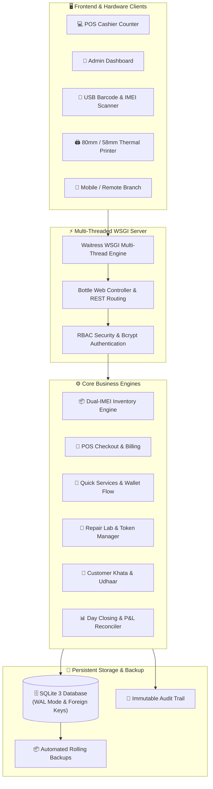

<div align="center">

# 📱 Apex Mobile & Accessories Shop ERP + POS System ⚡
### 💼 Enterprise Retail Management, Dual-IMEI Smartphone Tracking, Lightning POS & Multi-Branch Cloud Solution

[](https://www.python.org/)
[](https://bottlepy.org/)
[](https://docs.pylonsproject.org/projects/waitress/)
[-003B57.svg?logo=sqlite&logoColor=white)](https://www.sqlite.org/)
[](https://developer.mozilla.org/)
[](https://github.com/MuhammadAhmedAli26)
[](LICENSE)
[]()

<p align="center">
  <b>An ultra-fast, production-hardened Point-of-Sale (POS) and Enterprise Resource Planning (ERP) ecosystem specifically engineered for mobile phone retailers, smartphone wholesalers, and electronic repair labs.</b>
  <br />
  Runs 100% offline on local counters or deploys seamlessly to cloud infrastructure for real-time multi-branch synchronization.
</p>

[✨ Key Features](#-key-features) •
[🏗️ Architecture](#-system-architecture) •
[🛠️ Tech Stack & Skills](#-tech-stack--developer-skills) •
[🚀 Quick Start](#-quick-start-guide) •
[🌐 Multi-Branch Cloud Setup](#-multi-branch--cloud-deployment) •
[👨‍💻 Author Profile](#-author--developer)

---

</div>

## 🌟 Executive Summary

**Apex Mobile Shop ERP & POS** is engineered to eliminate the chaos of mobile retail management in fast-paced retail markets. It bridges physical hardware (barcode scanners, 80mm/58mm thermal printers, cash drawers) with robust accounting, dual-IMEI smartphone intake, repair lab ticketing, customer credit (Khata), digital wallet transactions (EasyPaisa & JazzCash), and financial day closing reconciliations.

Whether running as a standalone offline desktop application on a single laptop or deployed on cloud servers to connect multiple branch outlets, it delivers sub-25ms response times with zero crashes.

---

## ✨ Key Features

### 1. ⚡ Lightning-Fast POS Counter & Billing
* **Instant Barcode & SKU Lookup:** Type, scan, or pick items with instant search (< 2ms query latency).
* **Smart Device Allocation:** Sells specific smartphones by IMEI; automatically falls back to valid in-stock units without throwing `#0` missing unit bugs.
* **Flexible Payments:** One-click toggling between **Cash (Drawer)**, **Customer Khata (Udhaar)**, **Online Bank Transfer**, or **Credit/Debit Card**.
* **Thermal Receipt Printing:** Instant generation of professional 80mm and 58mm thermal receipts with 1-bit monochrome store logos, item specs, and return policies.

### 2. 📱 Dual-IMEI Smartphone Management (SIM 1 & SIM 2)
* **Pakistani Market Compliance:** Every smartphone in Pakistan carries dual IMEIs. Apex ERP natively pairs `IMEI 1` and `IMEI 2` under a single physical phone unit.
* **Universal Scanner Engine:** Barcode scanners can scan *either* IMEI 1 or IMEI 2 at checkout; the system resolves the exact device effortlessly.
* **Anti-Duplicate Protection:** Hardware-level database constraints prevent duplicate IMEIs across all active inventory.

### 3. 📲 Quick Services & Digital Wallets (EasyPaisa / JazzCash / Bills)
* **Smart Direction Tracking:**
  * 📤 **Send / Cash-In:** Customer pays cash; digital balance transferred from app; drawer cash increases; fee logged as pure profit.
  * 📥 **Receive / Cash-Out:** Customer transfers digital balance; drawer cash paid to customer; drawer cash decreases; commission earned.
  * 📱 **Mobile Load & Bills:** Bill collections and cellular top-ups with accurate commission margin calculations.
* **Live Cash Drawer Sync:** Real-time visual drawer balance calculation previews customer net impact before submission.

### 4. 🔧 Mobile Repair Lab & Service Token Management
* **Customer Intake Ticket:** Issue professional repair intake tokens with fault diagnosis, initial quote, and advance deposits.
* **Technician Assignment & Parts Accounting:** Track assigned technicians, spare parts used from inventory, labor charges, and net profit margins.
* **Status Lifecycles:** Real-time updates from `RECEIVED` ➡️ `IN_PROGRESS` ➡️ `READY_FOR_PICKUP` ➡️ `DELIVERED`.

### 5. 📒 360° Customer Udhaar & Khata Ledger
* **Zero-Loss Credit Ledger:** Comprehensive Khata tracking with customer phone, CNIC, and transaction history.
* **1-Click Udhaar Recovery:** Quick collection modal from sales screen or customer profile with instant thermal payment receipt printout.
* **Audit Trail:** Every payment reduces customer balance and feeds drawer cash or bank accounts transparently.

### 6. 📊 Financial Intelligence & Daily / Monthly Closing
* **Itemized Expense Engine:** Log every shop expense (Rent, Utilities, Chai, Salaries) with time stamps, category, and payment account (Cash vs Bank).
* **True Gross & Net Profit Calculation:** Unifies 5 income streams:
  $$\text{Net Profit} = (\text{POS Profit} + \text{Quick Services Comm.} + \text{Repair Labor} + \text{Software Jobs}) - \text{Expenses}$$
* **Closing Reports:** 80mm Thermal Z-Report for daily drawer cash count verification and full A4 Monthly Statements with itemized product sales and expense tables.

---

## 🏗️ System Architecture



---

## 🛠️ Tech Stack & Developer Skills

This project demonstrates full-stack software architecture, enterprise backend design, and hardware interop:

| Domain | Technology / Tool | Highlights & Competencies |
| :--- | :--- | :--- |
| **Backend Core** | `Python 3.10+`, `Bottle.py` | Clean MVC routing, RESTful API design, zero unnecessary bloat, ultra-high performance |
| **Concurrency & WSGI** | `Waitress`, `Beaker Session` | Multi-threaded concurrency (6 worker threads), secure session cookies, low CPU footprint |
| **Database Architecture** | `SQLite 3` (WAL Mode) | Write-Ahead-Logging (WAL) for lock-free read concurrency, foreign keys, ACID compliance |
| **Frontend UI/UX** | `HTML5`, `CSS3 Variables`, `Vanilla JS` | Dark-mode theme, keyboard navigation (F1-F12 shortcuts), zero external heavy JS dependencies |
| **Hardware Interoperability** | `ESC/POS Thermal Engine` | USB/Network thermal printer integration, 1-bit image dithering for logos, barcode parsing |
| **Security Engineering** | `Bcrypt`, `Audit Trails` | Salted password hashing, brute-force rate-limiting, 24-character master recovery keys |
| **DevOps & Packaging** | `PyInstaller`, `Git`, `Render / Docker` | Standalone `.exe` compilation, portable packaging, CI/CD workflows, cloud readiness |

---

## 🚀 Quick Start Guide

### Prerequisites
* Python 3.10 or higher installed
* Git installed

### 1. Clone Repository & Setup Environment
```bash
# Clone the repository
git clone https://github.com/MuhammadAhmedAli26/Mobile-Shop-ERP-POS.git
cd Mobile-Shop-ERP-POS

# Create virtual environment (recommended)
python -m venv venv
venv\Scripts\activate      # On Windows
# source venv/bin/activate  # On Linux/macOS

# Install dependencies
pip install -r requirements.txt
```

### 2. Launch Local Server
```bash
python main.py
```
Open your browser and navigate to:
```
http://127.0.0.1:8085
```

### 3. Default Login Credentials
* **Admin Portal:** Username: `admin` | Password: `admin123`
* **Counter POS:** Username: `staff` | Password: `staff123`
* **Admin Override PIN:** `9999`
* *(Credentials can be customized immediately in Settings -> Users & Permissions).*

---

## 🌐 Multi-Branch & Cloud Deployment

Want to run this ERP across multiple shop branches with real-time central database access? Deploy it to **Render.com** (100% Free & 1-Click):

### Step 1: Push to your GitHub
Make sure this repository is pushed to your GitHub account (`https://github.com/MuhammadAhmedAli26/Mobile-Shop-ERP-POS`).

### Step 2: Deploy on Render.com (1-Click)
1. Go to [Render.com](https://render.com) and sign in with GitHub.
2. Click **New +** ➡️ **Web Service**.
3. Select your repository: `Mobile-Shop-ERP-POS`.
4. Configure:
   * **Runtime:** `Python`
   * **Build Command:** `pip install -r requirements.txt`
   * **Start Command:** `python main.py`
5. Click **Create Web Service**.

🎉 **Done!** Render gives you a secure live URL:
`https://mobile-shop-erp-pos.onrender.com`

You and your staff can now open this URL from any computer, tablet, or smartphone in any branch simultaneously!

---

## 📂 Project Directory Structure

```text
├── config.py              # Environment, paths, security, and port configuration
├── db.py                  # Database initialization, SQLite WAL mode, migrations
├── auth.py                # Authentication, bcrypt hashing, rate-limiting, RBAC
├── inventory.py           # Products, variants, dual-IMEI units, stock ledger
├── pos.py                 # POS counter checkout, cart validation, barcode lookup
├── credit.py              # Customer Khata, udhaar payments, installment plans
├── services.py            # Quick Services, repairs, and software lab ticketing
├── accounting.py          # Day closing, itemized expenses, P&L calculations
├── printing.py            # ESC/POS thermal receipts and A4 closing PDF/HTML reports
├── web_ui.py              # Bottle web interface, routes, UI templates, modal dialogs
├── main.py                # Application entrypoint & Waitress multi-threaded runner
├── render.yaml            # Render.com cloud deployment specification
├── Procfile               # Cloud process file for containerized execution
├── requirements.txt       # Production dependencies
└── README.md              # Project documentation
```

---

## 👨‍💻 Author & Developer

<div align="center">

### **Muhammad Ahmed Ali**
🎓 **Artificial Intelligence & Software Engineering Student**  
🏫 **HITEC University Taxila**  
🔗 **GitHub:** [@MuhammadAhmedAli26](https://github.com/MuhammadAhmedAli26)  
✉️ **Email:** `24-ai-014@student.hitecuni.edu.pk` • `muhammadahmedali607@gmail.com`

*Passionate about building high-performance, real-world software solutions, scalable ERP systems, and intelligent business automation.*

---

⭐ **If you find this project useful, please star this repository on GitHub!** ⭐

</div>

---

## 📄 License
This project is open-source and licensed under the [MIT License](LICENSE).
